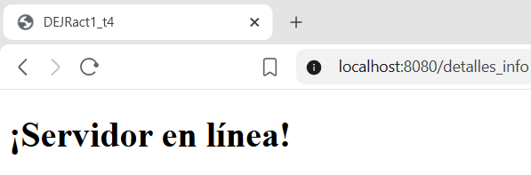

# 1. Act1. Introducción a Spring Boot.
## Se configuro mi entorno de desarrollo para Java y Spring Boot, creé mi primer proyecto desde Spring Initializr, desarrollé mis primeros controladores para atender peticiones web, y lo desplegue corriendo en el VPS y en mi equipo.
***
#### Elaborado por: David Efraín José Ramos NL 19
***
### Preguntas de la fase tres:
##### a) ¿Qué es un @Controller o @RestController en Spring Boot, y qué diferencia hay entre ambos?
El @Controller le indica al sistema que es una clase de tipo controlador. Un controlador se define usando algo que se conoce como anotaciones también va a manejar las rutas mediante algo llamado request mapping que es el método con que el controlador va a manejar esas solicitudes entonces recibe los datos de las solicitudes http y lo hace capturando los datos desde una URL que sería el cuerpo de esa solicitud y luego le devuelve una respuesta al elemento que hace la solicitud y esta respuesta que manda ese controlador puede ser un archivo eh de tipo json o xml o tratándose de página web html eso va  depender de los requisitos de eh Y la configuración que hagamos.

Ejemplo del video:

```java
    import org.springframework.stereotype.Controller;
    @Controller
```

##### b) ¿Qué anotación se usa para mapear una petición GET a un método, y cómo se le indica la ruta (endpoint)?
Para mapear una petición GET a un método se utiliza la anotación "@GetMapping" y para indicar la ruta (endpoint) se especifica la URL deseada entre comillas dentro de los paréntesis de la anotación.

Ejemplo del video:

```java
    @GetMapping("/detalles_info")
```

###### c) ¿Qué puerto usaste en tu VPS y por qué tuviste que definirlo manualmente en vez de dejar el que viene por defecto?
En el local use el puerto 8080, pero supongo que en VPS se tiene que cambiar porque vamos a crear diversos proyectos. En el video tuvieron un problema al correr su programa porque el puerto '8080' estaba ocupado. Es facil cambiarlo desde 'aplication.properties'.

Ejemplo: 

```java 
    server.port = 8080
```
##### d) Pega el enlace de tu repositorio de GitHub, y el link de tu proyecto ya corriendo en el VPS.

### Imagenes:

#### Proyecto subido al local 
#### Elaborado por: David Efraín José Ramos NL 19